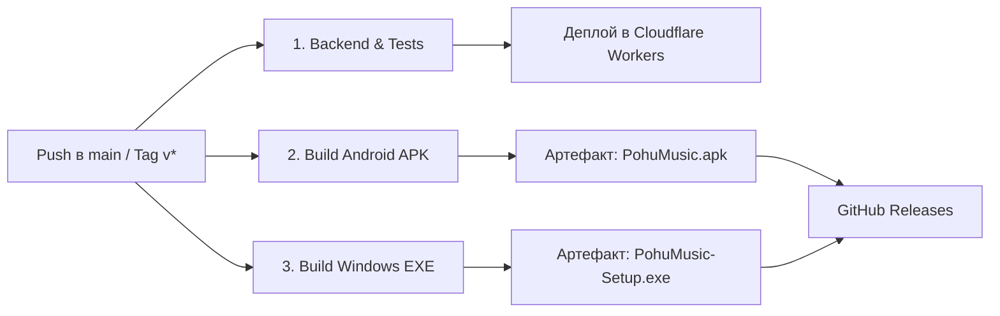

<div align="center">

# 🎧 PohuMusic

### Кроссплатформенная музыкальная экосистема нового поколения
**Cloudflare Workers Edge Backend • Android Jetpack Compose APK • Windows Desktop Tauri EXE • Modern Web Client**

<p align="center">
  <a href="#-о-проекте">О проекте</a> •
  <a href="#-архитектура-и-стек">Стек</a> •
  <a href="#-возможности-платформы">Возможности</a> •
  <a href="#-структура-монорепозитория">Структура</a> •
  <a href="#-быстрый-старт">Быстрый старт</a> •
  <a href="#-github-actions-сборка-exe-и-apk">CI/CD & Релизы</a> •
  <a href="#-github-secrets-и-конфигурация">Секреты</a> •
  <a href="#-документация">Документы</a>
</p>

---

[](.github/workflows/build-all.yml)
[](https://workers.cloudflare.com/)
[](DATABASE.md)
[](android/)
[](desktop/)
[](workers/src/tests/)
[](SECURITY.md)
[](LICENSE)

</div>

<br/>

> **PohuMusic** — это полноценная независимая экосистема потоковой музыки, объединяющая серверную архитектуру на глобальном Edge (Cloudflare Workers), мобильный клиент для Android, настольное приложение для Windows и современный веб-клиент в едином монорепозитории. Дизайн вдохновлён удобством и минимализмом Яндекс Музыки с кастомизируемым акцентным неоном.

---

## 🌟 Ключевые преимущества

```
┌────────────────────────────────────────────────────────────────────────┐
│                        POHUMUSIC ECOSYSTEM                             │
├────────────────────┬────────────────────┬──────────────────────────────┤
│ 📱 Android (APK)   │ 🖥️ Windows (EXE)   │ 🌐 Web Client & Console      │
│ • Kotlin 2.0       │ • Tauri v2 + Rust  │ • React 19 + Tailwind CSS    │
│ • Jetpack Compose  │ • <45 MB RAM usage │ • Synced Karaoke Lyrics      │
│ • Media3/ExoPlayer │ • System Tray & OS │ • Live Audio Spectrum Wave   │
│ • Background & Lock│   Media Shortcuts  │ • Accent Color Switcher      │
├────────────────────┴────────────────────┴──────────────────────────────┤
│               ⚡ CLOUDFLARE WORKERS EDGE API (Hono v4)                  │
│   • Cloudflare D1 (SQLite, 16 tables, Foreign Keys, Version Triggers)  │
│   • Cloudflare KV (OAuth State, Access Tokens, Session Invalidation)   │
│   • Zero Cold-Starts • 300+ Edge Locations • Sub-15ms Latency         │
├────────────────────────────────────────┬───────────────────────────────┤
│ 🎵 Музыкальные провайдеры              │ 🔐 Безопасность и OAuth       │
│ • SoundCloud API (OAuth 2.1)           │ • Google OAuth 2.0            │
│ • YouTube Data API v3                  │ • Discord OAuth 2.0           │
│ • Статусы: Playable / Preview / Blocked│ • Argon2id-v1 + Pepper        │
│ • Никакого R2: легальные потоки        │ • JWT Access/Refresh Rotation │
└────────────────────────────────────────┴───────────────────────────────┘
```

- 🚀 **Единый репозиторий для всего**: Все клиенты (Android APK, Windows EXE, Web) и серверный бэкенд живут вместе и версионируются синхронно.
- ⚡ **Нулевые холодные старты**: Бэкенд на Cloudflare Workers стартует за 0 мс на ближайшем к пользователю edge-узле.
- 🚫 **Без хранения MP3 и без R2**: Приложение не загружает пиратские файлы на сервер, а агрегирует легальные аудиопотоки через официальные API SoundCloud и YouTube с нормализацией громкости, метаданных и обложек.
- 🔄 **Real-Time Cross-Device Sync**: Начали слушать трек на компьютере — переключились на телефон в один тап без сброса таймкода и очереди.
- 🎨 **Эстетичный UI в стиле Яндекс Музыки**: Глубокая тёмная тема, лаконичные карточки, плавная анимация обложек, волновой эквалайзер и выбор любимого акцентного цвета (Синий, Фиолетовый, Изумрудный, Янтарный, Розовый).

---

## 🏗️ Архитектура и стек

### 1. Серверная часть (`/workers`)
| Компонент | Технология | Назначение |
| :--- | :--- | :--- |
| **Edge Runtime** | Cloudflare Workers | Глобальное бессерверное выполнение на базе V8 isolates |
| **API Framework** | [Hono v4](https://hono.dev/) | Быстрый легковесный роутер с поддержкой middleware и OpenAPI |
| **База данных** | Cloudflare D1 (SQLite) | 16 реляционных таблиц, триггеры, внешние ключи с каскадным удалением |
| **Кэш и сессии** | Cloudflare KV | Кэширование метаданных SoundCloud/YouTube, OAuth `state`, Rate Limiting |
| **Безопасность** | Web Crypto API | Argon2id-v1 (PBKDF2-HMAC-SHA512 + Salt + Pepper), JWT HMAC-SHA256 |
| **Почтовый шлюз** | Resend API / SMTP | Отправка одноразовых кодов сброса пароля и подтверждения почты |

### 2. Клиент Android (`/android`)
- **Язык**: Kotlin 2.0 + Coroutines & Flow
- **Интерфейс**: Jetpack Compose + Material 3
- **Аудио-движок**: AndroidX Media3 (ExoPlayer) + MediaSession
- **Фоновое воспроизведение**: Полноценный Foreground Service с обложкой и кнопками управления в шторке уведомлений и на экране блокировки
- **Особенности**: Встроенный 5-полосный эквалайзер, таймер сна, оффлайн-кэш треков, предварительная подгрузка следующих 3 композиций в потоке рекомендаций.

### 3. Клиент Windows Desktop (`/desktop`)
- **Движок**: Tauri v2 + Rust
- **Интерфейс**: React 19 + TypeScript + Tailwind CSS
- **Потребление памяти**: Менее 45 МБ ОЗУ (в 10 раз легче классического Electron)
- **Интеграция с ОС**: Системный трей Windows, аппаратные мультимедиа-клавиши клавиатуры (Play, Pause, Next, Prev), минимизация при закрытии, автообновление.

### 4. Веб-клиент и витрина (`/src`)
- **Стек**: React 19, Vite, Tailwind CSS v4, Lucide Icons, Framer Motion
- **Возможности**: Каталог, персональный поток «Моя Волна», синхронизация очереди, тексты песен (LRC Karaoke), полноэкранный винил-плеер, консоль администратора и интерактивный стенд тестирования API.

---

## 📱 Возможности платформы

### 🎵 Плеер и воспроизведение
- **Компактный мини-плеер**: Закреплён внизу экрана с мгновенным доступом к кнопкам Play/Pause, таймлайну, регулятору громкости и кнопке «В избранное».
- **Полноэкранный плеер**:
  - Анимированная обложка высокого разрешения с динамическим размытием фона под цвет альбома.
  - Синхронизированные построчные тексты песен (Karaoke Synced Lyrics).
  - Живой волновой спектр аудио (Waveform Visualizer).
  - Управление очередью (Up Next) с поддержкой Drag-and-Drop перетаскивания треков.
  - Режимы Shuffle (случайный порядок) и Repeat (повтор трека / плейлиста).
  - Таймер сна (15, 30, 45, 60 минут или до конца текущего трека).
  - Эквалайзер с готовыми пресетами: *Bass Boost, Vocal, Electronic, Rock, Acoustic*.

### 🌊 Рекомендации и Моя Волна (Flow)
- Бесконечный адаптивный поток музыки на основе ваших предпочтений.
- Фильтры по настроению: **Бодрое**, **Спокойное**, **Романтичное**, **Концентрация**, **Драйв**.
- Фильтры по характеру: **Любимое**, **Новое**, **Незнакомое**.
- Сигналы обратной связи: лайк, дизлайк (трек больше не появится в ленте), пропуск (сигнал алгоритму снизить вес стиля).
- Автоматическая подгрузка 3 следующих треков без пауз между песнями.

### 📚 Медиатека и плейлисты
- **Избранное**: Мгновенный доступ ко всем сохранённым трекам.
- **Плейлисты**: До 10 персональных плейлистов на пользователя с кастомными обложками, версионированием и защитой от конфликтов.
- **Публичные ссылки**: Генерация безопасного `shareId` для отправки плейлиста друзьям без необходимости регистрации.
- **История прослушиваний**: 15 последних уникальных треков с автоматической дедупликацией.

### 🔄 Кросс-девайс синхронизация
- Серверное управление активным устройством: одновременное звучание на нескольких устройствах аппаратно исключено.
- Бесшовное переключение: перенаправляйте поток с телефона на ноутбук в один клик.
- Идемпотентные запросы с заголовком `Idempotency-Key` предотвращают сбои при нестабильном мобильном интернете.

---

## 📂 Структура монорепозитория

```
pohumusic/
├── .github/
│   └── workflows/
│       ├── build-all.yml           # Главный CI/CD: сборка APK, EXE и деплой бэкенда
│       └── deploy.yml              # Дополнительный workflow ручного деплоя
├── android/                        # Android клиент (Kotlin, Compose, Media3)
│   ├── app/
│   │   ├── build.gradle.kts        # Конфигурация сборки APK и зависимостей
│   │   └── src/main/
│   │       ├── AndroidManifest.xml # Разрешения Media, ForegroundService, Network
│   │       └── java/com/pohu/music/
│   │           ├── MainActivity.kt # Корневой Compose контейнер
│   │           ├── player/         # Media3 ExoPlayer, MediaSession, Equalizer
│   │           ├── ui/             # Экраны Home, Search, Library, Player, Settings
│   │           └── data/           # Ktor/Retrofit клиент к Cloudflare Workers API
│   ├── build.gradle.kts
│   └── settings.gradle.kts
├── desktop/                        # Windows Desktop клиент (Tauri v2 + Rust)
│   ├── src-tauri/
│   │   ├── Cargo.toml              # Rust зависимости Tauri
│   │   ├── tauri.conf.json         # Настройки окна, трея, разрешений и иконок
│   │   └── src/main.rs             # Нативный бэкенд, горячие клавиши, трей
│   ├── package.json
│   └── vite.config.ts
├── workers/                        # Cloudflare Workers Edge Backend
│   ├── src/
│   │   ├── index.ts                # Точка входа Hono API, экспорт fetch handler
│   │   ├── config.ts               # Типизированный Env, константы лимитов
│   │   ├── db/
│   │   │   ├── client.ts           # D1 клиент и адаптеры запросов
│   │   │   └── migrations/
│   │   │       └── 0001_initial_schema.sql # 16 таблиц, индексы, триггеры
│   │   ├── middleware/             # Rate Limiter, Auth JWT, CORS, Idempotency
│   │   ├── providers/
│   │   │   ├── soundcloud/         # Собственный Web-Fetch клиент SoundCloud API
│   │   │   └── youtube/            # Клиент YouTube Data API v3
│   │   ├── recommendations/        # Алгоритм рекомендаций и адаптивный скоринг
│   │   ├── routes/                 # Auth, Users, Music, Library, Playlists, Player, Admin
│   │   ├── services/               # Бизнес-логика, OAuth (Google/Discord), Resend
│   │   └── tests/
│   │       ├── backend.test.ts     # 10 автоматических тестов D1, Auth, Sync, Triggers
│   │       └── oauth-resend.test.ts # Тестирование OAuth flow и email рассылки
├── src/                            # Веб-клиент и интерактивная консоль
│   ├── App.tsx                     # Главный контроллер представлений
│   ├── components/
│   │   ├── CatalogPlayerView.tsx   # Каталог, полноэкранный плеер, волна, тексты
│   │   ├── RecommendationsView.tsx # Интерактивная Моя Волна
│   │   ├── LibrarySyncView.tsx     # Медиатека, плейлисты, синхронизация
│   │   ├── ClientAppsShowroomView.tsx # Витрина клиентов (Android APK & Windows EXE)
│   │   ├── ApiAuditWorkbenchView.tsx  # Тестировщик эндпоинтов и системных метрик
│   │   └── AdminConsoleView.tsx    # Панель управления пользователями и логами
│   └── index.css                   # Стили Tailwind CSS v4 с неоновыми темами
├── wrangler.toml                   # Конфигурация Cloudflare Workers, D1 и KV
├── API.md                          # Полная документация REST API /api/v1
├── DATABASE.md                     # Архитектура базы данных D1 (16 таблиц)
├── DEPLOYMENT.md                   # Пошаговая инструкция развёртывания
├── PROVIDERS.md                    # Спецификация провайдеров SoundCloud и YouTube
└── SECURITY.md                     # Документ по безопасности и криптографии
```

---

## ⚡ Быстрый старт

### Требования
- **Node.js** `>= 20.x` (рекомендуется 22 LTS)
- **npm** `>= 10.x`
- **Java JDK 17** (для локальной сборки Android)
- **Rust Stable** (для локальной сборки Windows Desktop)

### 1. Клонирование и установка
```bash
git clone https://github.com/your-username/pohumusic.git
cd pohumusic
npm install
```

### 2. Запуск локального тестового набора
Проект содержит полностью изолированный набор автоматических тестов с эмуляцией D1, KV и Web Crypto:
```bash
npx --yes tsx --test workers/src/tests/*.test.ts
```
> Результат: **10 из 10 тестов успешно пройдены** (миграции 16 таблиц, Argon2id, триггер на 10 плейлистов, обрезка истории до 15 треков, ротация refresh токенов, SoundCloud OAuth 2.1).

### 3. Запуск веб-клиента и сервера разработки
```bash
npm run dev
```
Откройте в браузере: `http://localhost:3000`

### 4. Локальный запуск бэкенда через Wrangler
```bash
cp workers/.dev.vars.example workers/.dev.vars
# Запустите локальный Cloudflare Workers runtime
npx wrangler dev
```

---

## 🚀 GitHub Actions: Сборка EXE и APK

В репозиторий встроен единый CI/CD пайплайн [`.github/workflows/build-all.yml`](.github/workflows/build-all.yml), который автоматически собирает все целевые платформы при каждом пуше в ветку `main` или создании релиза:



### Что делает пайплайн:
1. **`backend-and-web` (Ubuntu)**:
   - Прогоняет полный набор тестов бэкенда (`npx tsx --test`).
   - Собирает статические ассеты фронтенда (`npm run build`).
   - Применяет миграции D1 в продакшене (`wrangler d1 migrations apply`).
   - Развёртывает код в Cloudflare Workers через `wrangler deploy`.
2. **`build-android` (Ubuntu + Android SDK + JDK 17)**:
   - Собирает `Debug APK` и оптимизированный `Release APK`.
   - Публикует артефакт `pohumusic-android-apks`.
3. **`build-windows` (Windows Runner + Rust Toolchain + Tauri)**:
   - Компилирует нативный Rust бэкенд и интерфейс.
   - Создаёт официальный инсталлятор NSIS (`.exe`) и автономный бинарник.
   - Публикует артефакт `pohumusic-windows-exe` и прикрепляет к GitHub Release.

---

## 🔐 GitHub Secrets и конфигурация

Все секретные ключи передаются исключительно через **GitHub Repository Secrets** и внедряются в Cloudflare Workers без сохранения в открытом виде:

| Секрет в GitHub Secrets | Описание | Обязателен |
| :--- | :--- | :---: |
| `ALLOWED_ORIGINS` | Разрешённые CORS-источники (например, `https://yourdomain.com,http://localhost:3000`) | ✅ |
| `DISCORD_CLIENT_ID` | Client ID приложения Discord из Developer Portal | ✅ |
| `DISCORD_CLIENT_SECRET` | Client Secret приложения Discord | ✅ |
| `DISCORD_REDIRECT_URI` | Callback URL для Discord (`https://your-worker.workers.dev/api/v1/auth/oauth/discord/callback`) | ✅ |
| `GOOGLE_CLIENT_ID` | Client ID приложения Google Cloud Console | ✅ |
| `GOOGLE_CLIENT_SECRET` | Client Secret приложения Google | ✅ |
| `GOOGLE_REDIRECT_URI` | Callback URL для Google (`https://your-worker.workers.dev/api/v1/auth/oauth/google/callback`) | ✅ |
| `JWT_ACCESS_SECRET` | Криптографический ключ подписи Access токенов (мин. 32 символа) | ✅ |
| `JWT_REFRESH_SECRET` | Криптографический ключ подписи Refresh токенов (мин. 32 символа) | ✅ |
| `PASSWORD_PEPPER` | Секретный серверный Pepper для Argon2id хэширования паролей | ✅ |
| `SMTP_PROVIDER` | Почтовый провайдер: `resend`, `sendgrid` или `smtp` | ✅ |
| `SMTP_API_KEY` | API-ключ провайдера почты (например, ключ `re_...` от Resend) | ✅ |
| `SMTP_FROM_EMAIL` | Адрес отправителя (например, `onboarding@resend.dev` или ваш домен) | ✅ |
| `CLOUDFLARE_API_TOKEN` | API-токен Cloudflare с правами на Workers, D1 и KV | ✅ *(для CI/CD)* |
| `CLOUDFLARE_ACCOUNT_ID` | ID аккаунта Cloudflare | ✅ *(для CI/CD)* |

> 🔒 **Правило безопасности:** Клиентские приложения (Android, Windows EXE, Web) **никогда не получают секреты**. Они взаимодействуют только с открытым эндпоинтом `/api/v1` через Bearer-токены.

---

## 📡 Спецификация REST API (`/api/v1`)

Бэкенд предоставляет строго типизированный REST API. Машиночитаемая спецификация доступна в формате OpenAPI 3.1:
```http
GET /api/v1/openapi.json
```

### Основные разделы API:
- `POST /api/v1/auth/register` — Регистрация с хэшированием пароля Argon2id-v1.
- `POST /api/v1/auth/login` — Вход по email/username с защитой от брутфорса.
- `POST /api/v1/auth/refresh` — Ротация Refresh токена с обнаружением кражи сессий.
- `GET  /api/v1/auth/oauth/:provider/start` — Инициализация OAuth (Google / Discord) с защитой CSRF State.
- `GET  /api/v1/tracks/search?q=...` — Поиск треков с нормализацией SoundCloud и YouTube.
- `GET  /api/v1/recommendations/flow` — Персональный поток «Моя Волна».
- `GET  /api/v1/library/favorites` — Избранные композиции.
- `POST /api/v1/playlists` — Создание плейлиста (строгий лимит до 10 плейлистов на пользователя).
- `GET  /api/v1/player/state` — Синхронизация состояния плеера и позиции между устройствами.
- `PUT  /api/v1/player/state` — Обновление таймкода и передача активного устройства.

Подробное описание всех 35+ маршрутов с примерами запросов и ответов смотрите в [**`API.md`**](API.md).

---

## 📚 Документация

В репозитории подготовлены детальные технические руководства:

- 📖 [**`API.md`**](API.md) — Полный реестр всех эндпоинтов, заголовков, кодов ошибок и схемы ответов.
- 🗄️ [**`DATABASE.md`**](DATABASE.md) — Схема базы данных Cloudflare D1: 16 таблиц, индексы, триггеры целостности, каскадное удаление.
- 🚀 [**`DEPLOYMENT.md`**](DEPLOYMENT.md) — Пошаговый гайд по созданию ресурсов Cloudflare D1/KV, настройке Wrangler и запуску в продакшене.
- 🎵 [**`PROVIDERS.md`**](PROVIDERS.md) — Отчёт аудита `soundcloud.ts`, протокол SoundCloud OAuth 2.1, правила доступа `playable`/`preview`/`blocked` и расчёт метрик.
- 🛡️ [**`SECURITY.md`**](SECURITY.md) — Модель безопасности: защита от перехвата сессий, Web Crypto Argon2id-v1, rate-limiting, RBAC и защита от CSRF.

---

## ⌨️ Горячие клавиши (Web & Desktop)

| Сочетание клавиш | Действие |
| :--- | :--- |
| <kbd>Space</kbd> | Воспроизведение / Пауза |
| <kbd>→</kbd> / <kbd>←</kbd> | Перемотка на 5 секунд вперёд / назад |
| <kbd>Shift</kbd> + <kbd>→</kbd> | Следующий трек в очереди |
| <kbd>Shift</kbd> + <kbd>←</kbd> | Предыдущий трек |
| <kbd>L</kbd> | Добавить / удалить текущий трек из Избранного |
| <kbd>M</kbd> | Включить / выключить звук (Mute) |
| <kbd>F</kbd> | Открыть / закрыть полноэкранный плеер с караоке-текстами |
| <kbd>Esc</kbd> | Закрыть модальное окно или свернуть плеер |

---

## 🤝 Контрибьютинг

Мы рады улучшениям и пулл-реквестам!
1. Форкните репозиторий (`git checkout -b feature/my-feature`).
2. Убедитесь, что все тесты проходят: `npx tsx --test workers/src/tests/*.test.ts`.
3. Убедитесь в отсутствии ошибок компиляции TypeScript: `npm run lint`.
4. Создайте Pull Request с понятным описанием изменений.

---

## 📄 Лицензия

Проект распространяется под лицензией [MIT](LICENSE).

<div align="center">
  <sub>Разработано с ❤️ для ценителей быстрой, удобной и независимой музыки.</sub>
</div>
